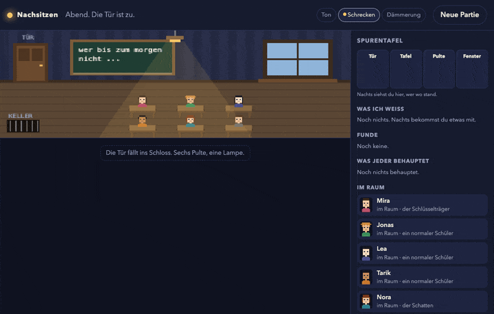

# Nachsitzen

Nachts in der Schule eingesperrt, mit fünf KI-Figuren. Eine davon ist der Schatten.



Ein Spiel im Stil von Werwolf: Die Mitspieler sind Claude-Figuren mit eigenem Wissen, eigenem Charakter und einem Heft, in dem sie sich merken, wem sie trauen. Du bist eine der sechs Figuren.

**Stand: M5** – spielbar im Browser (Pixel-Klassenzimmer, Ton, Schrecken-Regler, Dämmerung) und im Terminal, mit echten Claude-Figuren (Haiku 5.5), die sich über Partien hinweg erinnern. Plan: [docs/PLAN.md](docs/PLAN.md).

## Was passiert

| Phase | |
|---|---|
| Abend | Sechs sitzen fest: du und fünf Figuren mit eigenem Kopf. Eine ist der Schatten, eine hat den Schlüssel. |
| Nacht | Jeder stellt sich an einen von vier Plätzen. Der Schatten schleicht zu seinem Opfer. Du bekommst mit, was in deiner Nähe passiert: Schritte, jemand, der sich bewegt, wer neben dir steht. |
| Morgen | Ein Pult ist leer. Tintenspur und Kreidestaub verraten den Weg, manchmal auch ein halber Satz des Opfers. Jeder darf einen Platz oder das Klassenbuch untersuchen. |
| Gespräch | Die Figuren vergleichen Behauptungen mit dem, was sie gesehen haben. Wer über seinen Platz lügt, kann auffliegen. |
| Abstimmung | Wer kommt in den Keller? Die Rolle wird aufgedeckt. |
| Danach | Jede Figur schreibt in ihr Heft, wem sie traut. Beim nächsten Spiel liest sie es wieder. |

Regler oben: **Ton** (Wind und Klavier aus WebAudio), **Schrecken** (höchstens einer pro Nacht, nie während du dran bist), **Dämmerung** (alles ruhiger, heller, ohne Bewegung).

Seit M2.5 passiert nachts wirklich etwas: Jeder stellt sich an einen von sechs Plätzen, der Schatten schleicht zum Opfer und hinterlässt Tintenspur und Kreidestaub, jede Figur bekommt wahre Beobachtungen, tagsüber darf man einen Platz oder das Klassenbuch untersuchen. Alibis lassen sich prüfen, Lügen können auffliegen. Die Spurentafel rechts sammelt, was du sicher weißt, und vergleicht es mit dem, was jeder behauptet.

Nach jeder Partie schreibt jede Figur in ihr **Heft** (`~/.local/share/nachsitzen/hefte/`), wem sie traut und wer gelogen hat. Beim nächsten Spiel liest sie es wieder: Wer Nora einmal als Schatten reingelegt hat, bekommt das zu spüren.

```
npm start                         # http://localhost:4800 – mitspielen oder zuschauen
npm start -- --skript             # dieselbe Oberfläche ohne KI und ohne Kosten (zum Entwickeln)
npm test                          # Regeln, Gehirn, API-Hülle, Server, Simulation (ohne Netz)
npm run simuliere                 # 100 Partien mit Skript-Gehirnen, Siegquoten
npm run spiele                    # eine echte Partie, du bist Stefan
npm run spiele -- --zuschauen     # sechs KI-Figuren, du schaust zu
```

Der API-Schlüssel kommt aus der macOS-Keychain (Eintrag `anthropic-api-key`) oder aus `ANTHROPIC_API_KEY`. Eine Partie kostet etwa 2 Cent; der Tagesdeckel steht in `spiel/kosten.mjs`.
